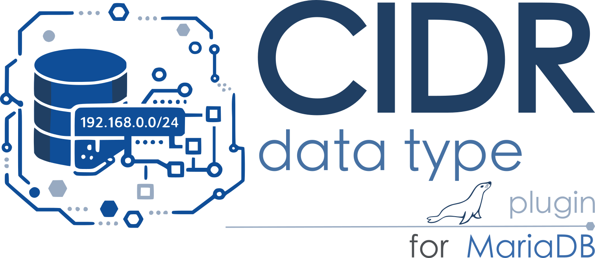

# mariadb-plugin-type-cidr




This plugin adds a native `CIDR` type for IPv4 and IPv6 networks. Values use
an 18-byte canonical binary representation (family, 16 network bytes, prefix),
so stored values are parsed once and compare naturally by family, network, and
prefix length. Host bits are cleared when a value is converted to `CIDR`.

Build this directory inside MariaDB Server's `plugin/` directory, then install:

```sql
MariaDB > INSTALL SONAME 'type_cidr';

MariaDB > SELECT plugin_name, plugin_type, plugin_library, plugin_description, plugin_author 
          FROM information_schema.PLUGINS WHERE plugin_library LIKE 'type_cidr.so';
+--------------------+-------------+----------------+---------------------------------------------+---------------+
| plugin_name        | plugin_type | plugin_library | plugin_description                          | plugin_author |
+--------------------+-------------+----------------+---------------------------------------------+---------------+
| cidr               | DATA TYPE   | type_cidr.so   | Fixed-size IPv4 and IPv6 CIDR data type     | lefred        |
| cidr_contains      | FUNCTION    | type_cidr.so   | Test whether a CIDR contains another        | lefred        |
| cidr_contained_by  | FUNCTION    | type_cidr.so   | Test whether a CIDR is contained by another | lefred        |
| cidr_overlaps      | FUNCTION    | type_cidr.so   | Test whether two CIDRs overlap              | lefred        |
| cidr_network       | FUNCTION    | type_cidr.so   | Return the canonical network                | lefred        |
| cidr_netmask       | FUNCTION    | type_cidr.so   | Return the network mask                     | lefred        |
| cidr_hostmask      | FUNCTION    | type_cidr.so   | Return the host mask                        | lefred        |
| cidr_broadcast     | FUNCTION    | type_cidr.so   | Return the last network address             | lefred        |
| cidr_prefix_length | FUNCTION    | type_cidr.so   | Return the prefix length                    | lefred        |
| cidr_family        | FUNCTION    | type_cidr.so   | Return 4 for IPv4 or 6 for IPv6             | lefred        |
| cidr_first_address | FUNCTION    | type_cidr.so   | Return the first network address            | lefred        |
| cidr_last_address  | FUNCTION    | type_cidr.so   | Return the last network address             | lefred        |
| cidr_address_count | FUNCTION    | type_cidr.so   | Return the number of addresses              | lefred        |
| cidr_supernet      | FUNCTION    | type_cidr.so   | Return a containing supernet                | lefred        |
| cidr_subnet        | FUNCTION    | type_cidr.so   | Return a numbered subnet                    | lefred        |
| cidr_adjacent      | FUNCTION    | type_cidr.so   | Test whether two CIDRs are adjacent         | lefred        |
| cidr_merge         | FUNCTION    | type_cidr.so   | Return the smallest common supernet         | lefred        |
+--------------------+-------------+----------------+---------------------------------------------+---------------+
17 rows in set (0.001 sec)
```

## Examples

```
MariaDB > CREATE TABLE networks (network CIDR NOT NULL, PRIMARY KEY (network));
MariaDB > INSERT INTO networks VALUES ('192.0.2.123/24'), ('2001:db8:1::1/48');
MariaDB > SELECT * FROM networks;
+-----------------+
| network         |
+-----------------+
| 192.0.2.0/24    |
| 2001:db8:1::/48 |
+-----------------+
2 rows in set (0.001 sec)
```

The plugin provides:

- `CIDR_CONTAINS(network, address)`, `CIDR_CONTAINED_BY(network1, network2)`,
  `CIDR_OVERLAPS(network1, network2)`
- `CIDR_NETWORK`, `CIDR_NETMASK`, `CIDR_HOSTMASK`, `CIDR_BROADCAST`
- `CIDR_PREFIX_LENGTH`, `CIDR_FAMILY`, `CIDR_FIRST_ADDRESS`,
  `CIDR_LAST_ADDRESS`, `CIDR_ADDRESS_COUNT`
- `CIDR_SUPERNET(value [, new_prefix])`,
  `CIDR_SUBNET(value, new_prefix, subnet_number)`
- `CIDR_ADJACENT(value1, value2)`, `CIDR_MERGE(value1, value2)`

Address-returning functions return canonical text. Network-returning functions
(`CIDR_NETWORK`, `CIDR_SUPERNET`, `CIDR_SUBNET`, and `CIDR_MERGE`) return CIDR.
`CIDR_ADDRESS_COUNT` returns decimal text so the IPv6 `/0` count is exact.

### Function examples

Each function accepts CIDR text directly (or a value from a `CIDR` column):

| Function | Example | Result |
|---|---|---|
| `CIDR_CONTAINS` | `CIDR_CONTAINS('192.0.2.0/24', '192.0.2.99')` | `1` |
| `CIDR_CONTAINED_BY` | `CIDR_CONTAINED_BY('192.0.2.128/25', '192.0.2.0/24')` | `1` |
| `CIDR_OVERLAPS` | `CIDR_OVERLAPS('192.0.2.0/25', '192.0.2.64/26')` | `1` |
| `CIDR_NETWORK` | `CIDR_NETWORK('192.0.2.129/24')` | `192.0.2.0/24` |
| `CIDR_NETMASK` | `CIDR_NETMASK('192.0.2.0/24')` | `255.255.255.0` |
| `CIDR_HOSTMASK` | `CIDR_HOSTMASK('192.0.2.0/24')` | `0.0.0.255` |
| `CIDR_BROADCAST` | `CIDR_BROADCAST('192.0.2.0/24')` | `192.0.2.255` |
| `CIDR_PREFIX_LENGTH` | `CIDR_PREFIX_LENGTH('2001:db8::/48')` | `48` |
| `CIDR_FAMILY` | `CIDR_FAMILY('2001:db8::/48')` | `6` |
| `CIDR_FIRST_ADDRESS` | `CIDR_FIRST_ADDRESS('2001:db8::/126')` | `2001:db8::` |
| `CIDR_LAST_ADDRESS` | `CIDR_LAST_ADDRESS('2001:db8::/126')` | `2001:db8::3` |
| `CIDR_ADDRESS_COUNT` | `CIDR_ADDRESS_COUNT('::/0')` | `340282366920938463463374607431768211456` |
| `CIDR_SUPERNET` | `CIDR_SUPERNET('192.0.2.0/24')` | `192.0.2.0/23` |
| `CIDR_SUPERNET` with a prefix | `CIDR_SUPERNET('192.0.2.0/24', 16)` | `192.0.0.0/16` |
| `CIDR_SUBNET` | `CIDR_SUBNET('10.0.0.0/8', 16, 2)` | `10.2.0.0/16` |
| `CIDR_ADJACENT` | `CIDR_ADJACENT('192.0.2.0/25', '192.0.2.128/25')` | `1` |
| `CIDR_MERGE` | `CIDR_MERGE('192.0.2.0/25', '192.0.2.128/25')` | `192.0.2.0/24` |

For example, the expressions can be run together in a regular `SELECT`:

```sql
SELECT CIDR_NETWORK('192.0.2.129/24') AS network,
       CIDR_BROADCAST('192.0.2.0/24') AS last_address;
```
